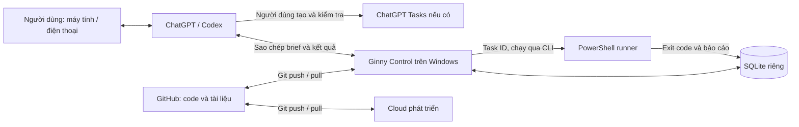

# Kiến trúc và giới hạn tích hợp

## Hai vai trò chính

**Executor** thực thi lệnh PowerShell trên máy đích qua runner. **Coordinator** phân tích yêu cầu, gợi ý ưu tiên, giao việc, xem kết quả và chuẩn bị nhắc việc. Coordinator sử dụng ChatGPT/Codex do người dùng điều khiển; Ginny Control lưu trạng thái, không chạy một mô hình AI nền.

## Công cụ giám sát được chọn

Ginny Control là ứng dụng nhỏ đi kèm repo, dùng Python + SQLite và giao diện web tiếng Việt. Nó cho phép giao việc theo sáu vai trò, biết việc nào đang làm/đang vướng/chờ duyệt, xem bằng chứng và xuất báo cáo. Không cần thêm tài khoản, API key hay phí dịch vụ. Không đo phần trăm tiến độ do AI tự ước lượng; trạng thái dựa trên lần cập nhật thực tế.

**n8n là lựa chọn nâng cấp**, khi cần lịch chạy nền, webhook và nhiều dịch vụ. Chưa cài n8n vì lựa chọn hiện tại là giao nhận thủ công; đưa thêm một server và API vào lúc này tăng công vận hành. Một thuê bao ChatGPT/Codex không được giả định là tín dụng API dùng bởi n8n. Khi chuyển sang tự động, chốt nhà cung cấp, ngân sách và kênh báo trước khi triển khai.

## Đồng bộ có nghĩa gì ở bản này?

- **GitHub** lưu code, `.md`, prompt, mẫu JSON và cấu trúc lệnh. Cloud và Windows lấy cùng một nhánh qua Git. Không đẩy tự động dữ liệu cá nhân hay toàn bộ lịch sử chat.
- **ChatGPT** có thể đồng bộ hội thoại giữa các thiết bị theo tính năng/tài khoản. Không phải kênh đồng bộ SQLite; việc đã dán vào chat có thể cũ hơn trạng thái trên bảng.
- **Ginny Control** lưu dữ liệu trên máy chạy dịch vụ. Chọn Windows làm nguồn trạng thái chính; cloud dùng dữ liệu thử nghiệm. Backup chuyển tay chỉ khi cần di chuyển, không gộp hai database.
- **ChatGPT Tasks** là kênh nhắc riêng. Tạo/sửa/hủy việc trong bảng không tạo/sửa/hủy Task trong ChatGPT. Cần cập nhật cả hai bằng tay, lưu lại xác nhận trong báo cáo. Không giả định Tasks gọi được runner hoặc dùng toàn bộ công cụ của một cuộc chat thường.

Muốn điện thoại đọc bảng và cập nhật trạng thái từ xa: giai đoạn sau cần một dịch vụ HTTPS có đăng nhập, database dùng chung, worker Windows kết nối ra ngoài, định danh thiết bị và cách xử lý việc chạy lặp. Không mở công khai server phát triển hiện tại.

## Điều kiện để tự động hóa tiếp

1. Thống kê khoảng 20 việc thực tế: loại việc, thời gian giao nhận, số lần sửa, phần thường lặp lại.
2. Chọn 1 luồng đáng tự động hóa, ví dụ báo cáo sáng; đặt trần chi phí ngày/tháng và tiêu chí dừng.
3. Nếu cần API: một gateway quản lý ngân sách, mã việc chống trùng, retry có giới hạn, log đã lọc thông tin nhạy cảm. Lấy giá và quyền truy cập từ tài liệu hiện hành của nhà cung cấp.
4. Chỉ thiết kế connector ChatGPT sau khi kiểm tra đúng loại tài khoản, nền tảng máy tính/điện thoại và công cụ tích hợp thực sự có sẵn. Không dựa vào tự động bấm giao diện để coi là tích hợp ổn định.

Thiết kế hiện tại ưu tiên một người dùng. Server dùng loopback, kiểm tra Host/Origin khi thay đổi dữ liệu; đây không phải cơ chế đăng nhập dùng cho Internet. Quá trình PowerShell chạy có quyền của tài khoản khởi chạy; ba lệnh hiện tại chỉ đọc dữ liệu.
