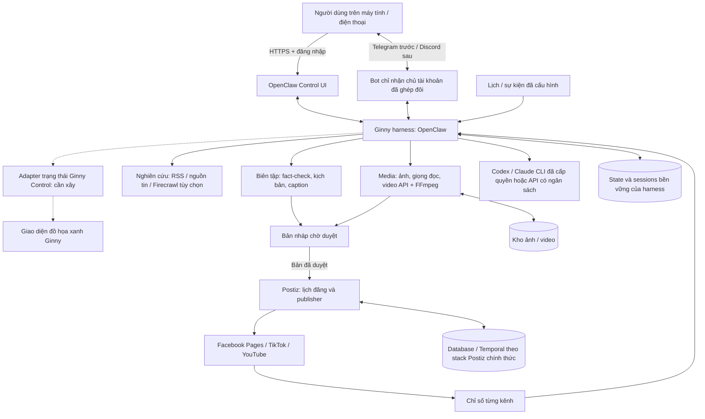

# Kế hoạch Ginny Social AI chạy 24/7

Trạng thái: đã chuẩn bị bộ cấu hình thử nghiệm OpenClaw, chưa cài trên server người dùng. Server chưa kết nối; chưa có budget/key API riêng; chưa xác minh quyền tài khoản mạng xã hội. Telegram trước, Discord sau; chưa có domain. Không có lời gọi model trả phí hoặc bài đăng nào được thực hiện trong bước chuẩn bị này. Xem [hướng dẫn và bằng chứng kiểm tra](openclaw-setup.md).

Cập nhật 01/11/2026: người dùng đã cài Ubuntu 26.04 LTS và gửi log qua chat; OAM quản trị tách riêng, frontend yêu cầu React/Vite/Node.js. Dùng [hướng dẫn Ubuntu](ubuntu-server-setup.md) và [thiết kế OAM/tài nguyên](server-oam-resources.md) cho cấu hình mới. Các con số 20 CPU/32 GB/2 TB bên dưới là kế hoạch ban đầu, không thay cho số đo máy thật. Phiên Codex vẫn chưa có kết nối điều khiển server.

## Mục tiêu và kiến trúc đề xuất



Đây là kiến trúc đích. Bộ cấu hình mới tách OpenClaw khỏi Python/SQLite của Ginny hiện tại. Adapter bảng xanh, connector media và Postiz chưa được nối. Server Python loopback hiện có không được đổi thành server công khai chỉ bằng bind `0.0.0.0`. Không dùng hai bảng độc lập như thể trạng thái đã tự đồng bộ.

**24/7 nghĩa là dịch vụ luôn sẵn sàng**, nhận sự kiện và chạy theo lịch. Model được gọi theo nhu cầu; không để một vòng tự trò chuyện giữa các agent chạy không nghỉ.

## Nhóm agent theo nghiệp vụ

| Nhóm | Trách nhiệm | Đầu ra/bằng chứng |
|---|---|---|
| Trend & Research | Thu thập nguồn được chọn, gộp tin trùng, chấm điểm độ mới/liên quan/độ tin cậy | Topic brief có URL nguồn, thời điểm và lý do chọn |
| Editorial | Kiểm chứng, chọn góc kể, viết kịch bản/caption theo từng kênh | Bản nháp với dữ kiện cần kiểm chứng và phiên bản |
| Media | Tạo ảnh/thumbnail, TTS/phụ đề, dựng video | File thật, tỷ lệ/độ dài/định dạng, chi phí tạo và quyền sử dụng nguồn |
| Publishing | Nhận bản được duyệt, lên lịch, đăng qua connector | Job ID và post/video ID nền tảng; đối soát khi timeout |
| Analytics | Đọc metrics được cấp quyền, so sánh với baseline, đề xuất thử nghiệm nội dung | Báo cáo theo bài/kênh, ngày thu thập và độ trễ dữ liệu |
| Operations | Theo dõi lỗi, API quota, ngân sách, backup, hàng đợi | Cảnh báo và bằng chứng phục hồi; không tự mua thêm credit |

Ginny Coordinator chọn bước tiếp theo và giao việc. Các thao tác xác định được như lọc trùng, resize ảnh, FFmpeg, lịch đăng và cộng số liệu dùng code; không cần LLM cho từng thao tác nhỏ.

Bộ cấu hình thử nghiệm có Ginny và năm agent chuyên môn đầu tiên; Operations trước mắt dùng health check/log và người quản trị, không cần một agent luôn suy nghĩ. Chỉ khai báo vai trò không làm những agent này chạy được khi chưa đăng nhập model và chưa cấp công cụ.

## Truy cập từ xa và kênh chat

- **Chưa có tên miền:** thử UI qua SSH tunnel trước. Telegram long polling chỉ cần kết nối HTTPS ra ngoài, không bắt buộc có domain hay mở cổng webhook.
- **Giao diện public:** chuẩn bị domain/subdomain, HTTPS và reverse proxy; giữ Gateway token + ghép đôi thiết bị. Nếu server sau CGNAT, cần tunnel có danh tính hoặc điểm vào công khai phù hợp; chỉ mở router port không giải quyết CGNAT. Chưa chọn dịch vụ tunnel hay mua domain thay người dùng.
- **Telegram:** tạo bot riêng bằng BotFather, lưu token ngoài Git, ghép đôi đúng Telegram user ID. Ban đầu tắt nhóm và không cho chat sửa cấu hình. Kiểm chứng nhận việc → tiến độ → báo cáo bằng tài khoản thật sau khi có kết nối.
- **Discord:** thêm sau khi Telegram đạt tiêu chí; bot riêng, giới hạn server/channel/user. Viber chưa xác minh connector phù hợp. OpenClaw có tài liệu Zalo thử nghiệm nhưng không được đánh đồng với mọi loại tài khoản/Zalo OA.
- Bản đầu chỉ cấp công cụ session/điều phối; không mount Docker socket, ổ Windows hay cả filesystem server vào agent. Khi cần tool chạy code/media, xây worker riêng với quyền và thư mục cụ thể. Allowlist của OpenClaw cần đối chiếu cả quyền runtime Codex/Claude CLI; không mặc định CLI bị chặn mọi native tool chỉ nhờ một JSON allowlist.

## Server Ubuntu đã được mô tả

- 20 nhân CPU, RAM 32 GB, HDD 2 TB: đủ để thử nghiệm các dịch vụ điều phối và pipeline dùng model API; chưa đo hiệu năng trên máy thật.
- Chưa có thông tin GPU: không lập kế hoạch chạy mô hình tạo video lớn tại máy. Ưu tiên xử lý media bằng FFmpeg/ảnh mẫu và gọi dịch vụ tạo media khi có ngân sách.
- HDD có thể hạn chế I/O của PostgreSQL, queue và nhiều lần dựng video. Nếu có thể, bổ sung SSD cho OS/database/cache; HDD giữ media/archive. SSD là cải thiện được đề xuất, không phải điều kiện bắt buộc để bắt đầu thử.
- Khởi đầu 1–2 tác vụ AI đồng thời và 1 tác vụ dựng video; đây là giới hạn thử nghiệm đề xuất, điều chỉnh sau đo tải. 20 nhân không có nghĩa nên cho 20 agent gọi API cùng lúc.
- Không cần GUI trên Ubuntu. Quản trị bằng SSH; các dashboard có thể dùng từ trình duyệt Windows/điện thoại sau khi có HTTPS và đăng nhập.

## Lưu trữ

Quy ước dự kiến trên Ubuntu, cần xác nhận mount thực tế trước khi tạo thư mục hoặc cấu hình Docker:

```text
/srv/ginnyai/
  source/        # checkout code, .md, cấu hình không chứa bí mật
  config/        # cấu hình triển khai riêng; quyền truy cập hạn chế
  data/          # database/queue/checkpoint theo từng dịch vụ
  media/         # ảnh, video, phụ đề và đầu ra
  backups/       # bản sao lưu nhất quán
  logs/          # log có giới hạn dung lượng/thời gian giữ
```

Không có ổ `E:` trên Ubuntu. `E:\GinnyAI` vẫn là workspace Windows; Git đồng bộ code/tài liệu. Server sẽ là nguồn trạng thái công việc 24/7 khi chuyển sang mô hình server chung; không đồng bộ database đang mở bằng Git. Named volumes Docker mặc định có thể nằm ở `/var/lib/docker` chứ không tự vào HDD 2 TB; cần kiểm tra filesystem và cấu hình vị trí persistent data theo đúng dịch vụ. Không thay đổi partition hoặc di chuyển Docker root một cách mù quáng.

## Những kết nối thực sự cần có

**Facebook:** xác nhận đang quản lý Pages hay tài khoản cá nhân; thiết kế này nhắm Facebook Pages. Cần Meta developer app, OAuth/token của Page và quyền đăng/đọc chỉ số phù hợp. Không mặc định đăng vào mọi profile/group.

**TikTok:** developer app và quyền Content Posting/đọc dữ liệu phù hợp; khả năng đăng công khai phụ thuộc trạng thái xét duyệt/quyền của app và tài khoản. Không dùng tự động bấm trình duyệt để coi như đã vượt các điều kiện đó.

**YouTube:** Google Cloud project, OAuth của chủ kênh, API tải video và quyền đọc analytics theo nhu cầu; theo dõi quota và kết quả xử lý video. Khi thử, dùng video riêng tư trước khi xác nhận bài đăng thật.

README Postiz self-host nêu rõ người dùng tự tạo developer apps và xin quyền; không phải chỉ nhập một LLM API key. Code provider được đọc có các scope như `pages_manage_posts`, `read_insights`, `video.publish`, `video.upload`, `youtube.upload`, `yt-analytics.readonly`; đây không phải lời khẳng định tài khoản hiện đã có các quyền đó. Xác minh bộ quyền tối thiểu và quy định hiện hành khi cấu hình từng app.

“Tin hot” cần có danh sách chủ đề, thị trường/ngôn ngữ và nguồn được phép truy cập. RSS/nguồn báo công khai là điểm khởi đầu gọn. Firecrawl không tự cung cấp quyền truy cập mọi dữ liệu xu hướng của Facebook/TikTok/YouTube. Không gộp view/engagement của ba nền tảng thành một KPI mà không ghi rõ định nghĩa và thời điểm đo.

**Tạo ảnh/video từ tài khoản hiện có:** “highfeel” và “muse” chưa xác định sản phẩm; cần URL chính xác. Veo có nhiều đường sử dụng (ví dụ sản phẩm giao diện web so với Gemini API/Vertex AI); quyền gói web không tự trở thành API credit. Sau khi xác định dịch vụ, kiểm tra API chính thức, quyền gói, quota và phí; nếu chỉ có giao diện web, giai đoạn đầu xuất brief và nhận file thủ công. Không dùng cookie trình duyệt để hứa tích hợp 24/7. Worker media cần lưu job ID, poll có giới hạn, tải file và xác minh file hoàn tất; không coi URL nhận việc là video đã tạo.

## Ngân sách và chọn model

Các gói ChatGPT 100 USD và Claude 20 USD không được đưa vào cấu hình như API credits. Tài liệu OpenClaw mô tả runtime Codex subscription và Claude CLI; thử đường đăng nhập chính thức được tài khoản hỗ trợ trước. Chưa xác minh quyền/quota của hai tài khoản. Không tự fallback sang API tính tiền khi hết quota thuê bao. Các tính năng embedding, web search và media phải kiểm tra cách tính phí riêng.

Bản cấu hình ban đầu tắt cron, heartbeat và memory embedding; không chèn API key/model trả phí. Tối đa hai agent run chính và hai subagent trong mỗi phiên cha, timeout subagent mặc định 300 giây; đây không phải trần USD hay trần tổng subagent của mọi phiên. Native runtime có giới hạn riêng cần kiểm chứng khi đăng nhập. Chỉ bật lịch sau khi thử một công việc, cách dừng, quota và phục hồi.

Sau khi có budget riêng:

1. Dùng một provider trước và chọn model nhỏ cho phân loại/tóm tắt, model mạnh chỉ cho việc có giá trị hoặc cần review. Tên model phải lấy từ danh sách model mà key thực sự truy cập được.
2. Đặt trần chi theo ngày/tháng, số lượt/tool và thời gian của mỗi job; có nút dừng toàn hệ thống. Ngân sách ước tính cần kiểm tra trước khi tạo media, sau đó đối soát usage thực tế. Một hạn mức cấu hình ở gateway không bảo đảm mọi request đang chạy đều dừng ngay tại đúng con số USD.
3. Tách tiền văn bản, ảnh, giọng nói, video, tìm kiếm và hạ tầng. Không hứa một ngân sách văn bản nhỏ sẽ đủ cho nhiều video tạo sinh dài.
4. Cache theo URL/content hash, gộp tin trùng, chỉ gửi trích đoạn liên quan; lưu source/brief/artifact ID để agent khác đọc khi cần. Chỉ load skill/tool đúng nhóm và đo số lượt sửa lại, không chỉ đo độ dài câu trả lời.
5. Có thể cân nhắc pilot API trần nhỏ như 20–30 USD/tháng **sau khi người dùng quyết định**. Đây là đề xuất để đo thử, chưa được duyệt, chưa chi và không phải báo giá đảm bảo sản lượng.

## Các giai đoạn triển khai có tiêu chí hoàn tất

### A. Kiểm tra server và nền tảng

Chạy [scripts/check-server.sh](../scripts/check-server.sh) trên Ubuntu bằng tài khoản quản trị bình thường. Script chỉ đọc thông tin máy/công cụ/ổ đĩa, không cài, không đổi firewall, không đọc key. Kết quả từ cloud hiện tại không thay cho kết quả trên server thật.

Xác định kết nối SSH/VPN, Docker Compose, filesystem `/srv`, kiến trúc CPU x86_64 và đường truy cập dashboard. Bộ image đang pin linux/amd64; nếu server ARM phải chọn và kiểm tra digest ARM riêng. Chưa yêu cầu dán password hoặc API key vào chat.

### B. Harness, chat và giao diện quản trị

Theo [openclaw-setup.md](openclaw-setup.md): chuẩn bị state riêng, validate cấu hình, khởi động, kiểm tra UI/auth/health và restart. Đăng nhập Codex chính thức nếu gói cho phép; xác minh runtime/billing và một tác vụ nhỏ. Kết nối Telegram bằng pairing, giữ group disabled. Sau khi có domain, cấu hình HTTPS/origin rồi kiểm tra từ điện thoại qua mạng di động. Chưa có domain vẫn thử qua SSH tunnel được.

Chưa bật lịch model hoặc công cụ xuất bản. Kiểm tra hết quota, mất mạng và khởi động lại trước khi xem là vận hành ổn định. Nếu runtime không cho các tool/subagent cần thiết hoặc không phù hợp quyền gói, giữ giao nhận thủ công và đánh giá API có budget; Deep Agents/LangGraph là phương án tùy biến sau.

### C. Social hub

Dùng hướng dẫn [Docker Compose Postiz chính thức](https://github.com/gitroomhq/postiz-docs/blob/main/self-host/installation/docker-compose.mdx) và repo [postiz-docker-compose](https://github.com/gitroomhq/postiz-docker-compose). Sau khi xem cấu hình thực tế, pin release/image digest đã kiểm tra, tạo secret riêng và đặt persistent data vào volume đã chọn. Không dùng `docker-compose.dev.yaml` trong repo ứng dụng làm production: file đó ghi rõ dành cho phát triển, có password mẫu và nhiều cổng dịch vụ.

Postiz hiện có phụ thuộc Temporal; phải kiểm tra stack compose hiện hành thay vì giả định chỉ có app + Redis. Đo tài nguyên khi chạy, kiểm tra UI, database, queue, upload asset, đăng nhập và khôi phục sau restart. Thử một kênh trước; các kênh còn lại không được báo đã hoạt động khi OAuth/quyền chưa xong.

Viết adapter theo job/role hiện có của Ginny và sự kiện runtime để giao diện xanh hiển thị công việc thật. Tách session suy luận khỏi trạng thái nghiệp vụ: phiên bản nội dung, bản duyệt và ý định xuất bản. Kiểm chứng adapter bằng dữ liệu giả lập ghi nhãn rõ trước, sau đó một job thật; không dùng diễn hoạt UI làm bằng chứng agent đang làm việc.

### D. Pipeline một chiến dịch

Chọn một chủ đề và một tài khoản thử: tìm nguồn → brief → kịch bản → media → người dùng duyệt → lên lịch → xác nhận post ID → thu metrics. Bản duyệt cần gắn với nội dung, asset, kênh và lịch cụ thể; thay bản sau khi duyệt thì yêu cầu duyệt lại phần bị thay đổi.

Chống đăng trùng bằng một bản ghi ý định đăng có ID duy nhất theo content version/channel/schedule. Khi upload hoặc publish timeout, truy vấn trạng thái nhà cung cấp trước khi gửi lại; không tuyên bố exactly-once chỉ vì có khóa nội bộ.

### E. Chạy 24/7

Dịch vụ có restart policy/systemd và health check; jobs/checkpoints lưu bền vững; scheduler có lease/khóa chống chạy trùng; retry theo loại lỗi, có backoff và giới hạn; trường hợp hết quyền/quota/chưa duyệt được chuyển sang chờ xử lý. Có backup và thử restore, log rotation, cảnh báo hết dung lượng/key hết hạn/ngân sách cạn, và diễn tập reboot server.

Chỉ công nhận sẵn sàng 24/7 sau khi thử restart/reboot và quan sát ít nhất một chu kỳ lịch + báo cáo thực tế. Bật container hoặc có PID chưa đủ chứng minh.

## Điều kiện còn thiếu để thực hiện trên máy thật

- Kết nối tới server và kết quả preflight; Docker/mount/mạng chưa xác minh; chưa có domain.
- Đăng nhập runtime chính thức theo quyền thuê bao và kiểm tra quota; chỉ khai báo API key khi có quyết định ngân sách riêng. Không lưu key trong Git/chat.
- URL chính xác của highfeel/muse và nơi người dùng truy cập Veo để chọn connector thật.
- Danh sách Pages/kênh, quyền developer app/OAuth, chủ đề và sản lượng mục tiêu; các thông tin này cần cho việc kết nối/pilot chứ không cản đánh giá repo.

Chưa có bước nào ở B–E được tuyên bố đã chạy trên server người dùng.
