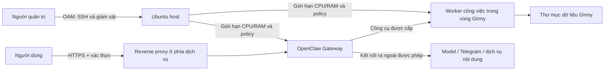

# Tách OAM khỏi Ginny và phân bổ tài nguyên

Yêu cầu đã chốt ngày 01/11/2026: SSH/giám sát đi qua mạng OAM riêng; agent không quản lý mạng này. Phía dịch vụ có đường ra Internet/IP public theo mô tả của người dùng. Các interface nhìn thấy trong log máy dùng IP RFC1918 nên phải xác minh NAT/routing và IP public thật tại thiết bị phía trước. Không ghi địa chỉ nội bộ vào repo.

## Ranh giới quản trị



Không có đường agent → quyền sửa OAM. Không cung cấp cho agent sudo, SSH key quản trị, Docker socket, host network, `/dev` hay quyền ghi `/etc`. Sự tách biệt phải do firewall/OS/container thực thi, không chỉ là câu trong prompt. Việc OAM không có Internet không tự ngăn một tiến trình trên máy hai card kết nối vào OAM.

Compose tạo bridge riêng `br-ginny` để firewall có interface ổn định. **Có bridge riêng chưa phải đã cô lập OAM.** Sau khi biết interface, dải quản trị và backend firewall thực tế:

1. Với Docker dùng iptables backend, đặt quy tắc tương ứng ở `DOCKER-USER` để từ bridge Ginny không khởi tạo kết nối đi qua interface OAM hoặc tới các dải OAM. Với backend khác, dùng cơ chế chính thức tương ứng; không tạo chain giả rồi coi đã bảo vệ.
2. Chặn kết nối mới từ bridge Ginny vào các dịch vụ quản trị trên **host** ở INPUT; traffic tới host không nhất thiết đi qua `DOCKER-USER`. Giữ reply của các kết nối hợp lệ. Cân nhắc DNS, proxy, adapter nội bộ cần dùng trước khi đóng.
3. Worker chạy trực tiếp trên host cần identity/firewall riêng; chỉ chặn bridge không bảo vệ các tiến trình host. Ưu tiên worker trong vùng container riêng, không host network.
4. Không đổi route/netplan, interface OAM, port SSH hoặc rule quản trị hiện có từ công cụ AI. Chưa xác minh SSH key thì giữ password login qua OAM.
5. Kiểm tra từ vùng Ginny rằng kết nối khởi tạo tới OAM bị từ chối; từ máy quản trị xác nhận SSH/giám sát vẫn hoạt động. Kiểm tra chiều ngoài vào, IPv6, restart Docker và reboot. Ghi bằng chứng rule counters/trạng thái kết nối; chưa thực hiện kiểm tra này trên server người dùng.

Gateway chỉ publish loopback 18789. Trước khi có domain/auth/proxy và policy OAM đã kiểm chứng, dùng SSH tunnel cho thử nghiệm UI; không bật native shell/browser hoặc các connector có khả năng tùy ý gọi địa chỉ nội bộ. Rootless Docker/VM riêng có thể tăng tách biệt nhưng không thay kiểm tra egress và quyền file.

## CPU/RAM và dung lượng thư mục

Log người dùng gửi cho thấy RAM khoảng **22 GiB**, filesystem `/` khoảng **98 GiB**, còn khoảng **83 GiB** trống; `/srv` ở cùng filesystem. Có đĩa 1,5 TB, partition LVM lớn hơn root LV, nhưng chưa có `vgs/lvs` hoặc bảng vùng trống để kết luận phần nào sẵn dùng. Không coi mô tả ban đầu 32 GB RAM/2 TB là số đo máy thật. Không mở rộng partition/LV trong bước này.

| Thành phần | Thiết lập ban đầu | Trạng thái |
|---|---|---|
| OpenClaw Gateway | Tối đa 2 CPU, 4 GB RAM, 256 PID; log 3 × 10 MB | Có trong Compose; chỉ được thực thi khi container chạy trên máy thật |
| Dashboard Ginny | Tài khoản dịch vụ không sudo, chỉ ghi database; tối đa 1 CPU/1 GB RAM | Có unit template `deploy/systemd/ginny-control.service`; chưa cài trên server |
| Media worker | Chưa bật; đo tải trước khi thêm tác vụ FFmpeg/model | Chưa triển khai |
| Media/cache | Bắt đầu bằng ngân sách dung lượng nhỏ và theo dõi filesystem | Chưa có quota cứng cho bind-mounted directory |

`mem_limit` chỉ giới hạn RAM container, không giới hạn dung lượng thư mục. Bind mount hoặc `mkdir` không tự tạo quota. Cấp quota filesystem thực cần kiểm tra loại FS/cơ chế quota và có thể cần thay đổi mount; chưa nằm trong bước CPU/RAM và thư mục đầu tiên. Có thể dùng admission check dung lượng trống, giới hạn kích thước đầu vào/đầu ra, retention và cảnh báo ở worker khi worker được triển khai; không gọi các cơ chế chưa viết là đã có.

Ginny có thể đọc tài nguyên qua collector chỉ đọc và đưa đề xuất phân bổ. Tự thay đổi CPU/RAM/dung lượng chỉ qua broker có danh sách dịch vụ Ginny được quản lý và giới hạn tối đa, lưu audit, giữ phần dự phòng cho host/OAM; **broker này chưa được viết**. Không trao Docker socket trực tiếp cho model để đạt khả năng đó. Quản trị viên vẫn có thể sửa giới hạn Compose bằng tay, kiểm tra rồi khởi động lại dịch vụ.

Đọc thêm tình trạng cấp phát, không làm thay đổi đĩa:

```bash
nproc
vgs
lvs -o lv_name,vg_name,lv_size,devices
findmnt -T /srv
df -hT / /srv
```

## Dịch vụ thử nghiệm cũ

Người dùng cho phép bỏ Nginx/Node thử giao diện. Xác định unit sở hữu cổng qua `scripts/audit-server.sh`; stop/disable đúng unit hoặc PM2 process, kiểm tra port đã đóng. Không xóa dữ liệu hoặc dừng mọi process Node. Có thể tái dùng package Nginx cho reverse proxy; thay frontend sang React/Vite không yêu cầu gỡ Nginx hay thay đổi SSH.
